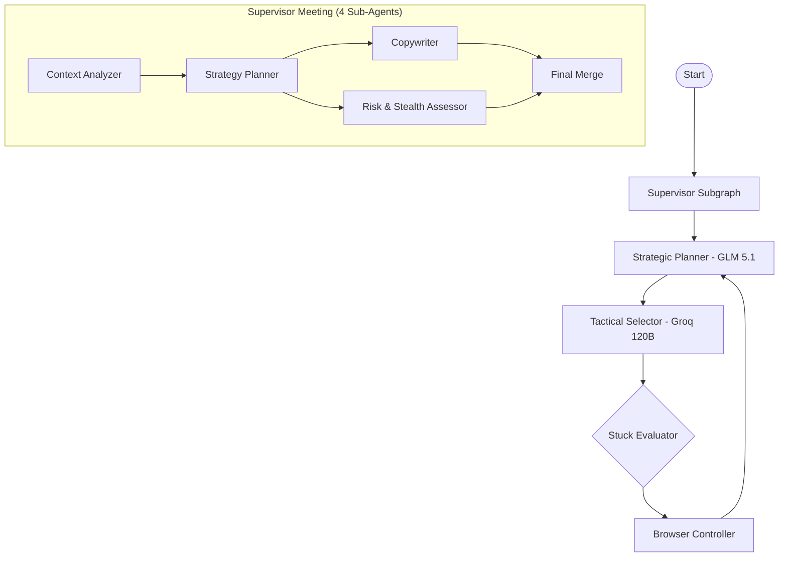

# Agent First IDE

> Autonomous AI-powered browser agent with crash-proof session persistence, multi-model orchestration, and real-world marketing automation.

[](https://python.org)
[](https://langchain-ai.github.io/langgraph/)
[](https://playwright.dev/python/)
[](#)

---

## Architecture

The system provides two execution modes:

### 1. Advanced Single-Agent Mode (`advanced_agent.py`) — **Recommended**

A streamlined, high-performance browser automation agent that bypasses the complex multi-agent graph in favor of a tight action loop:

```
Extract DOM → Query LLM → Execute Playwright Action → Repeat
```

**Key Features:**
- **Single-model driving** — Uses Groq GPT-OSS-120B for lightning-fast JSON tactical decisions
- **Crash-proof session persistence** — 4-layer protection (user_data_dir + storage_state injection + periodic auto-save + signal handlers)
- **Google OAuth support** — Leverages persisted Gmail session for "Continue with Google" flows on platforms like Dev.to, Hashnode, etc.
- **Zero stuck loops** — Action history injection prevents the model from repeating itself

### 2. Multi-Agent Swarm Mode (`start_campaign.py`) — Legacy

Full LangGraph orchestrator with Supervisor subgraph + Worker nodes:



**Model Hierarchy (Linear, No Load Balancing):**
- **Strategic Planner**: NVIDIA GLM-5.1 → Gemma 4 (backup)
- **Tactical Executor**: Groq GPT-OSS-120B → Gemma 4 (backup)
- **Vision Tool**: Google Gemma 4 (on-demand)

---

## Session Persistence (Crash-Proof)

The biggest challenge in browser automation is keeping authentication sessions alive across restarts. This project implements a **4-layer persistence strategy**:

| Layer | Protection | Mechanism |
|---|---|---|
| **Layer 1** | Normal restarts | Chromium `user_data_dir` (native disk storage) |
| **Layer 2** | WSL cookie corruption | `storage_state` JSON injection via `add_cookies()` |
| **Layer 3** | Mid-task crashes | Periodic auto-save every 3 steps during execution |
| **Layer 4** | Ctrl+C / SIGTERM / exceptions | `SessionGuard` singleton with signal handlers + atexit + triple-attempt finally block |

**Atomic writes** prevent file corruption. A `.backup.json` is maintained as a fallback.

---

## Quick Start

### 1. Clone & Setup

```bash
git clone https://github.com/SandeepAi369/agent-first-ide.git
cd agent-first-ide
python3 -m venv .venv
source .venv/bin/activate
pip install -r python-orchestrator/requirements.txt
playwright install chromium
```

### 2. Configure Environment

```bash
cp .env.example .env
# Edit .env with your API keys (GOOGLE_API_KEY, GROQ_API_KEY, NVIDIA_NIM_API_KEY, etc.)
```

### 3. Login (One-Time)

```bash
python3 advanced_agent.py login
```

A browser window opens. Log into your Google/Gmail account manually, then press ENTER in the terminal. Your session is saved to `persistence/session_state.json` and will survive all future restarts.

### 4. Run Agent Tasks

```bash
# Simple test (Wikipedia search)
python3 advanced_agent.py run "Go to https://en.wikipedia.org, search for Alan Turing, and verify the article title."

# Form fill test
python3 advanced_agent.py run "Go to https://the-internet.herokuapp.com/login, type 'tomsmith' as username, type 'SuperSecretPassword!' as password, click Login, verify success."

# Marketing task (Dev.to article)
python3 advanced_agent.py run "Go to https://dev.to, log in with Google, create a new post about your project, and publish it."
```

---

## Project Structure

```
agent-first-ide/
├── advanced_agent.py                  # Single-agent browser automation (recommended)
├── start_campaign.py                  # Legacy multi-agent campaign launcher
├── check_cookies.py                   # Cookie inspection utility
├── test_form_fill.py                  # Swarm testing script
├── .env                               # API keys (git-ignored)
├── .gitignore
├── README.md
├── persistence/                       # Runtime data (git-ignored)
│   ├── session_state.json             # Saved cookies + localStorage
│   ├── session_state.backup.json      # Backup state
│   └── browser_sessions/             # Chromium profiles
├── python-orchestrator/
│   ├── requirements.txt
│   ├── app/
│   │   ├── config.py                  # Centralized environment configuration
│   │   ├── logger.py                  # Structured logging
│   │   ├── observability.py           # LangSmith tracing
│   │   └── browser_promoter/
│   │       ├── state.py               # Pydantic state models
│   │       ├── graph.py               # LangGraph compilation
│   │       ├── nodes.py               # All graph nodes + DOM extraction
│   │       ├── browser_runtime.py     # Playwright persistent context runtime
│   │       ├── cdp_stealth_launcher.py # Stealth hardening (UA, canvas, WebGL)
│   │       ├── worker_planner.py      # Strategic + Tactical + Vision planners
│   │       ├── supervisor_subgraph.py # 4-agent supervisor meeting
│   │       ├── database.py            # SQLite persistence
│   │       ├── dashboard.py           # Terminal status dashboard
│   │       ├── github_intelligence.py # GitHub repo analysis for marketing
│   │       └── marketing_engine.py    # Platform strategy engine
│   └── tests/
└── scripts/
```

---

## Environment Variables

| Variable | Required | Description |
|---|---|---|
| `GOOGLE_API_KEY` | ✅ | Google key for Gemma 4 models (vision + backup) |
| `NVIDIA_NIM_API_KEY` | ❌ | NVIDIA NIM key for GLM-5.1 strategic planner |
| `GROQ_API_KEY` | ❌ | Groq key for GPT-OSS-120B tactical executor |
| `OPENAI_API_KEY` | ❌ | Fallback key for OpenAI-compatible providers |
| `BROWSER_HEADLESS` | ❌ | Run browser headless (default: `false`) |
| `DRY_RUN_MODE` | ❌ | Skip destructive actions (default: `true`) |
| `MAX_CYCLES` | ❌ | Maximum graph cycles (default: `15`) |

---

## Safety & Security

- **Private repository** — All code and credentials stay private
- **`.gitignore` protection** — `.env`, `persistence/`, browser profiles, and cookies are never committed
- **Dry-run mode** — Destructive actions are skipped by default
- **Stealth hardening** — WebDriver masking, canvas noise, WebGL spoofing, 12 browser fingerprint profiles
- **Crash-proof saves** — Session state is always preserved, even on crashes

---

## License

MIT © SandeepAi369
