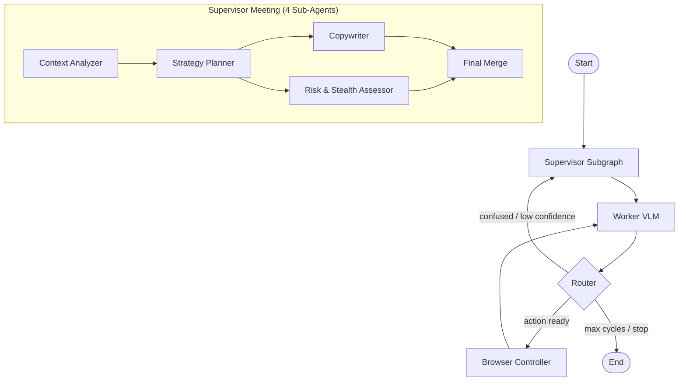

# Agent First IDE

> Dual-model LangGraph browser automation orchestrator with Supervisor + Worker VLM architecture.

[](https://python.org)
[](https://langchain-ai.github.io/langgraph/)
[](https://playwright.dev/python/)

---

## Architecture



### Key Components

| Component | File | Role |
|---|---|---|
| **State** | `state.py` | Canonical Pydantic state with campaign context, screenshot history, routing flags |
| **Supervisor** | `supervisor_subgraph.py` | 4-agent meeting: Context → Strategy → Copy + Risk → Merge |
| **Worker** | `worker_planner.py` | Vision-Language Model that maps commands to physical browser actions |
| **Browser** | `browser_runtime.py` | Persistent Playwright runtime with stealth, 3 connectivity modes |
| **Router** | `nodes.py` | Circuit-breaker routing with HITL pause support |
| **Database** | `database.py` | SQLite persistence for campaigns, vector memory, target communities |
| **Graph** | `graph.py` | LangGraph compilation with optional checkpointer and HITL interrupt |

---

## Prerequisites

- **Python** 3.11 or higher
- **Playwright** Chromium browser (installed via `playwright install chromium`)
- **OpenAI API key** (or compatible provider)

---

## Quick Start

### 1. Clone & Navigate

```bash
git clone https://github.com/SandeepAi369/agent-first-ide.git
cd agent-first-ide
```

### 2. Create Virtual Environment

```bash
python3 -m venv .venv
source .venv/bin/activate
```

### 3. Install Dependencies

```bash
pip install -r python-orchestrator/requirements.txt
playwright install chromium
```

### 4. Configure Environment

```bash
cp .env.example .env
# Edit .env with your API keys
```

### 5. Run Dry Demo

```bash
cd python-orchestrator
python -m scripts.run_dry_demo
```

---

## Environment Variables

| Variable | Required | Default | Description |
|---|---|---|---|
| `OPENAI_API_KEY` | ✅ | — | OpenAI API key for LLM calls |
| `WORKER_VLM_API_KEY` | ❌ | Falls back to `OPENAI_API_KEY` | Separate key for Worker VLM |
| `WORKER_VLM_MODEL` | ❌ | `gpt-4.1-mini` | Model name for Worker planning |
| `SUPERVISOR_LLM_MODEL` | ❌ | `gpt-4.1-mini` | Model name for Supervisor sub-agents |
| `BROWSER_MODE` | ❌ | `ISOLATED_SERVER` | `LOCAL_NATIVE_CDP` / `ISOLATED_SERVER` / `REMOTE_WEBSOCKET` |
| `BROWSER_HEADLESS` | ❌ | `true` | Run browser in headless mode |
| `DRY_RUN_MODE` | ❌ | `true` | Skip destructive actions (post/reply/submit) |
| `MAX_CYCLES` | ❌ | `15` | Maximum graph execution cycles |

---

## Project Structure

```
agent-first-ide/
├── .gitignore
├── .env.example
├── README.md
├── pyproject.toml
├── python-orchestrator/
│   ├── requirements.txt
│   ├── app/
│   │   ├── __init__.py
│   │   ├── config.py              # Centralized environment configuration
│   │   ├── logger.py              # Shared structured logging
│   │   └── browser_promoter/
│   │       ├── __init__.py
│   │       ├── state.py           # Pydantic state models
│   │       ├── graph.py           # LangGraph compilation
│   │       ├── nodes.py           # Supervisor, Worker, Router, Browser nodes
│   │       ├── dashboard.py       # Terminal status dashboard
│   │       ├── supervisor_subgraph.py
│   │       ├── database.py        # SQLite persistence
│   │       ├── worker_planner.py  # Vision-Language Model planner
│   │       └── browser_runtime.py # Playwright runtime manager
│   └── tests/
│       ├── conftest.py
│       ├── test_state.py
│       ├── test_database.py
│       └── test_graph.py
└── scripts/
    └── run_dry_demo.py
```

---

## Browser Modes

| Mode | Use Case |
|---|---|
| `ISOLATED_SERVER` | Launch a fresh Chromium with persistent profile (default, safest) |
| `LOCAL_NATIVE_CDP` | Attach to an already-running Chrome via CDP on `localhost:9222` |
| `REMOTE_WEBSOCKET` | Connect to a remote browser instance via WebSocket URL |

---

## Safety Features

- **Dry-run mode** — destructive actions (post, reply, submit) are highlighted but not executed
- **HITL pause** — automatic pause when login walls, captchas, or MFA are detected
- **Cycle limit** — hard cap at 15 cycles (configurable) to prevent runaway loops
- **Confidence threshold** — Worker routes back to Supervisor when confidence drops below 0.4

---

## Development

```bash
# Install dev dependencies
pip install -r python-orchestrator/requirements.txt
pip install pytest pytest-asyncio mypy ruff

# Run tests
pytest python-orchestrator/tests/ -v

# Lint & format
ruff check python-orchestrator/
ruff format python-orchestrator/

# Type check
mypy python-orchestrator/app/ --ignore-missing-imports
```

---

## License

MIT © SandeepAi369
