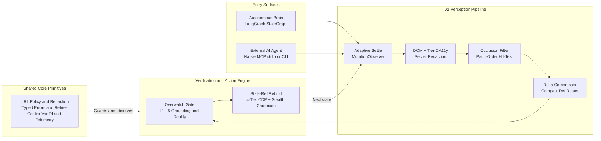

<div align="center">

# 🌐 Agent First Browse

**Fast, token-efficient autonomous browser control for AI agents.**
*Accessibility-tree-first perception · LangGraph verification · Native zero-API MCP & CLI*

<p>
  <a href="https://pypi.org/project/agent-first-browse/"></a>
  <a href="https://python.org"></a>
  <a href="https://langchain-ai.github.io/langgraph/"></a>
  <a href="https://playwright.dev/python/"></a>
  <a href="https://github.com/SandeepAi369/Agent-first-browse/blob/main/docs/EVAL_CONNECTOR.md"></a>
  <a href="https://github.com/SandeepAi369/Agent-first-browse/blob/main/docs/TEST_COVERAGE_MATRIX.md"></a>
  <a href="https://github.com/SandeepAi369/Agent-first-browse/blob/main/LICENSE"></a>
</p>

<p>
  <a href="#live-demo">Demo</a> ·
  <a href="#why-agent-first-browse">Capabilities</a> ·
  <a href="#architecture">Architecture</a> ·
  <a href="#verified-benchmarks">Benchmarks</a> ·
  <a href="#quick-start">Quick Start</a> ·
  <a href="#documentation">Docs</a>
</p>

</div>

---

## Live Demo

<div align="center">

[](https://github.com/SandeepAi369/Agent-first-browse/blob/main/docs/assets/raw/agent_first_browse_demo_1280x720.webm)

<sub>
  <strong>Prompt:</strong> <em>"Sort products Low → High, add the 2 cheapest items to cart, and complete checkout"</em><br>
  Live <code>perceive_v2</code> perception (<strong>136.9 ms/step</strong> avg · <strong>~119 tokens/step</strong>) · Smooth Bézier cursor · Character-by-character input<br>
  <a href="https://github.com/SandeepAi369/Agent-first-browse/blob/main/docs/assets/raw/agent_first_browse_demo_1280x720.webm">Watch full 1280×720 HD recording (WebM)</a> ·
  <a href="https://github.com/SandeepAi369/Agent-first-browse/blob/main/scripts/record_visual_demo.py">Demo script</a>
</sub>

</div>

<br>

| ⚡ Perception Speed | 🪙 Prompt Efficiency | 🔌 Zero-API Agent Control | ✅ Automated Verification |
| :---: | :---: | :---: | :---: |
| **12.0× faster** | **54.8% fewer tokens** | **Native MCP + CLI** | **528 passing tests** |
| `96.8 ms` avg vs `1,164 ms` legacy | Up to **95% saved** behind modals | 7 stdio tools + `0600` Unix daemon | `ruff`, `mypy`, guardrails & Chromium CI |

---

## Why Agent First Browse?

Most browser agents burn thousands of tokens per step on raw DOM dumps, sleep on fixed timers, or click stale coordinates behind overlays. **Agent First Browse** treats the browser as a structured, verifiable environment for AI agents:

| Pillar | How It Works |
|---|---|
| **⚡ Adaptive DOM Settle** | `MutationObserver` quiet-window settle replaces rigid 1.5s sleeps — cutting perception latency by **10–12×** while waiting cleanly for SPA renders. |
| **🎯 Paint-Order Occlusion Pruning** | Live `elementFromPoint` + Shadow DOM hit-testing removes background links trapped behind modals, cookie walls, and overlays (up to **95% token savings**). |
| **📉 Incremental Delta Snapshots** | Consecutive same-URL steps emit only `+ADDED` / `~CHANGED` / `-REMOVED` controls alongside a compact ref roster (**35–79% fewer prompt tokens**). |
| **🌳 Tier-2 Accessibility-Tree Rescue** | Automatically escalates to CDP/Playwright Accessibility Trees whenever Tier-1 DOM scans go sparse (`< 2` elements) on custom ARIA web components. |
| **🔁 Stale-Ref Rebind & 4-Tier CDP** | Verifies live `window.__aid` handles, semantically rebinds buttons moved by SPA re-renders, and executes clicks/typing via trusted CDP with React-reversion recovery. |
| **🛡️ Defense-in-Depth Safety** | Masks passwords, OTPs, PINs, and cards before they reach prompts or logs; enforces RFC 6890 SSRF URL policies, typed errors, and full-jitter retries (`src/core/`). |

---

## Architecture

Drive real Chromium either **autonomously** through the LangGraph verification brain or **directly from any AI coding agent** (Antigravity, Claude Code, Cursor, VS Code, Gemini CLI) with zero external LLM API keys:



---

## Verified Benchmarks

Measured on live **headed Chromium** (`headless=False`, zero external LLM API keys, AI agent acting directly as the decision-making brain across live websites and diagnostic stress scenarios):

| Scenario | Legacy Baseline | V2 Engine | Measured Impact |
|---|---|---|---|
| **Hacker News** (`news.ycombinator.com`) | `1,528 ms` · `~2,194 tok` | `153 ms` · `~1,419 → 482 tok` | **10.0× faster** · **35–78% fewer tokens** |
| **Blocking Modal** (`modal_occlusion`) | `1,520 ms` · `~621 tok` (46 els) | `143 ms` · `~31 tok` (2 els) | **10.7× faster** · **95.0% fewer tokens** (`44` pruned) |
| **SPA Mid-Step Rerender** (`spa_rerender`) | ❌ **FAIL** (clicked stale coords) | ✅ **PASS** (`1,676 ms`) | **Live stale-ref semantic recovery** |
| **Custom ARIA Widgets** (`sparse_aria`) | `0` elements (blind) | `4` elements (`tier=2` A11y) | **Automatic Tier-2 A11y escalation** |
| **Cumulative Session Average** | **`1,164.4 ms` · `754.2 tok/step`** | **`96.8 ms` · `341.1 tok/step`** | **12.0× faster · 54.8% fewer tokens/step** |

<details>
<summary><strong>View full 7-scenario headed benchmark matrix</strong></summary>

<br>

| Test | Legacy (`--mode legacy`) | V2 (`--mode v2`) | Gain |
|---|---|---|---|
| `the-internet.herokuapp.com/login` (full → delta) | `1,527 ms` / `~113–122 tok` | `140–148 ms` / `~55–71 tok` | **10.3–10.8× faster**, **42–51% fewer tokens** |
| `news.ycombinator.com` (Step 1 full / Step 2 delta) | `1,524–1,531 ms` / `~2,194 tok` | `151–155 ms` / `~1,419 → 482 tok` | **9.9–10.1× faster**, **35–78% fewer tokens** |
| `modal_occlusion` (blocking pop-up) | `1,520 ms` / `~621 tok` (46 els, 44 blocked) | `143 ms` / `~31 tok` (2 dialog btns) | **10.7× faster**, **95.0% fewer tokens**, **44 occluded pruned** |
| `spa_rerender` (shifted button click) | **FAIL** (`3,080 ms`, clicked stale coords) | **PASS** (`1,676 ms`, rebound to moved btn) | **Stale-ref semantic recovery** |
| `sparse_aria` (custom ARIA roles) | `0` elements found (blind) | `4` elements found (`tier=2` A11y) | **Automatic Tier-2 A11y rescue** |
| `multistep_form` (Step 2 review reveal) | `1,517 ms` / `~540 tok` (secret masked) | `141 ms` / `~256 tok` (`delta`, secret masked) | **10.8× faster**, **52.6% fewer tokens** |
| `a11y_visibility` (hidden ghosts & hints) | `1,515 ms` / `~91 tok` | `138 ms` / `~60 tok` | **11.0× faster**, **34.1% fewer tokens** |

</details>

---

## Quick Start

Requires **Python 3.11+** on Linux, WSL, or macOS.

```bash
# Install from PyPI
pip install agent-first-browse && python -m playwright install chromium

# Or install from source
git clone https://github.com/SandeepAi369/Agent-first-browse.git && cd Agent-first-browse
python3 -m venv .venv && source .venv/bin/activate
pip install -e . && python -m playwright install chromium
```

### Run Your First Task

```bash
# Autonomous LangGraph run (configure keys once via: cp .env.example .env)
agent-first-browse run --mode v2 "Open https://news.ycombinator.com and find the top 3 stories"
```

Want **zero external API keys**? Connect Antigravity, Claude Code, Cursor, VS Code, or Gemini CLI directly via native MCP or the stateful CLI daemon:

<details>
<summary><strong>🔌 Connect via Native MCP Server (<code>agent-eval-mcp</code> — 7 tools, zero API keys)</strong></summary>

<br>

Copy [`.mcp.json.example`](https://github.com/SandeepAi369/Agent-first-browse/blob/main/.mcp.json.example) into your MCP client config:

```json
{
  "mcpServers": {
    "agent-first-browse-eval": {
      "command": ".venv/bin/python",
      "args": ["-m", "eval_connector.mcp_server"],
      "env": {
        "PYTHONPATH": "src"
      }
    }
  }
}
```

| Tool | Purpose |
|---|---|
| `eval_start` | Launch a `legacy`, `v2`, or twin `pair` Chromium session (`headless: true/false`). |
| `eval_perceive` | Run live perception and return compact ref elements + step telemetry. |
| `eval_act` | Execute `goto`, `click`, `type`, `hover`, `select_option`, `press_enter`, `press_key`, `scroll`, or `wait`. |
| `eval_compare` | Diff `legacy` vs `v2` sessions side-by-side (latency, tokens, occlusion, visibility). |
| `eval_screenshot` | Save a viewport or full-page PNG screenshot to disk. |
| `eval_metrics` | Export cumulative Markdown/JSON telemetry and scenario catalog. |
| `eval_stop` | Close one session or shut down all active sessions cleanly. |

</details>

<details>
<summary><strong>💻 Drive via Stateful CLI Daemon (<code>agent-eval</code> — zero API keys)</strong></summary>

<br>

```bash
# Start paired Legacy + V2 sessions on any live URL (add --headed to watch on screen)
agent-eval start-pair live --url https://news.ycombinator.com --headed

# Compare speed, tokens, occlusion pruning, and element visibility side-by-side
agent-eval compare live_legacy live_v2

# Step-by-step perception and actions
agent-eval perceive live_v2
agent-eval act live_v2 click e1 --auto-perceive
agent-eval screenshot live_v2

# Export cumulative report and shut down cleanly
agent-eval report --json-out eval_report.json
agent-eval stop --daemon
```

*(Without `pip install -e .`, replace `agent-eval` with `.venv/bin/python scripts/agent_eval.py`.)*

</details>

<details>
<summary><strong>⚙️ Additional Autonomous CLI Options & Headed Xvfb Setup</strong></summary>

<br>

```bash
# Optional on headless Linux/WSL for stealth headed display inside Xvfb
sudo apt-get install -y xvfb

# Run with baseline legacy mode for side-by-side comparison
./agent.sh --mode legacy "Open https://news.ycombinator.com and find the top 3 stories"

# Invoke Python directly (add --headless to run without a display)
.venv/bin/python src/run_v16.py run --mode v2 "Log in to https://the-internet.herokuapp.com/login and verify the secure area"
```

</details>

<details>
<summary><strong>🧪 Quality Gates, Guardrails & Test Suite</strong></summary>

<br>

```bash
# Full offline unit + local-Chromium test suite (528 tests)
.venv/bin/pytest -q

# Architectural guardrails (frozen modules, universal-only perception, exports, secrets, test hygiene)
.venv/bin/python scripts/check_guardrails.py --strict-test-hygiene

# Scoped lint & progressive typecheck (mirrors GitHub Actions CI)
.venv/bin/ruff check src/core src/v2_engine src/eval_connector scripts/check_guardrails.py
.venv/bin/mypy src/core src/v2_engine src/eval_connector scripts/check_guardrails.py

# Built-in side-by-side Legacy vs V2 local stress benchmark (zero API keys)
.venv/bin/python scripts/benchmark_v2_vs_legacy.py --suite local
```

</details>

---

## Documentation

| Guide | Contents |
|---|---|
| [`AGENTS.md`](https://github.com/SandeepAi369/Agent-first-browse/blob/main/AGENTS.md) | Engineering handbook, package boundaries, frozen-file rules, and verification commands. |
| [`docs/EVAL_CONNECTOR.md`](https://github.com/SandeepAi369/Agent-first-browse/blob/main/docs/EVAL_CONNECTOR.md) | Complete Zero-API MCP + CLI connector guide, scenarios, and headed benchmark results. |
| [`docs/TEST_COVERAGE_MATRIX.md`](https://github.com/SandeepAi369/Agent-first-browse/blob/main/docs/TEST_COVERAGE_MATRIX.md) | Subsystem-by-layer test coverage rollup and CI gate mapping. |
| [`docs/V2_ECOSYSTEM_AUDIT_2026.md`](https://github.com/SandeepAi369/Agent-first-browse/blob/main/docs/V2_ECOSYSTEM_AUDIT_2026.md) | V2 perception & resilient action engine design rationale. |
| [`docs/V29_OVERHAUL.md`](https://github.com/SandeepAi369/Agent-first-browse/blob/main/docs/V29_OVERHAUL.md) | V29 cognitive reliability layers (Reality Monitor, Intent Journal, Sub-Goal Lock). |

---

## License & Support

- Licensed under the **Apache License 2.0** — see [`LICENSE`](https://github.com/SandeepAi369/Agent-first-browse/blob/main/LICENSE).
- If you find **Agent First Browse** useful, consider starring the repo or supporting ongoing open-source development via [GitHub Sponsors](https://github.com/sponsors/SandeepAi369).
